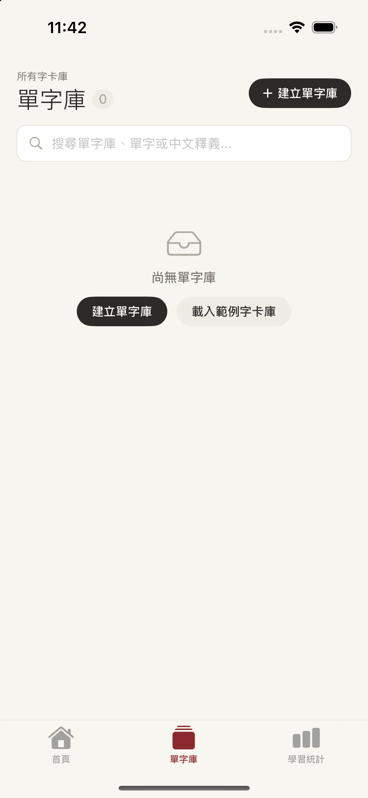
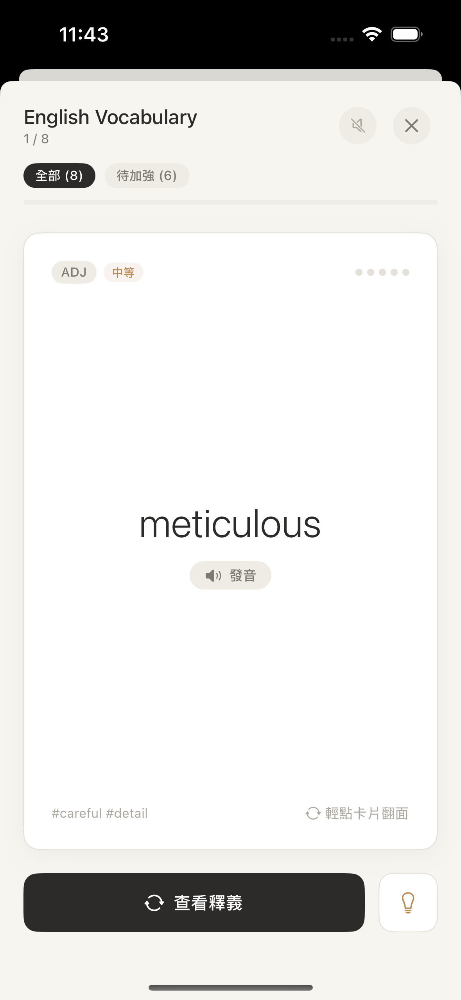
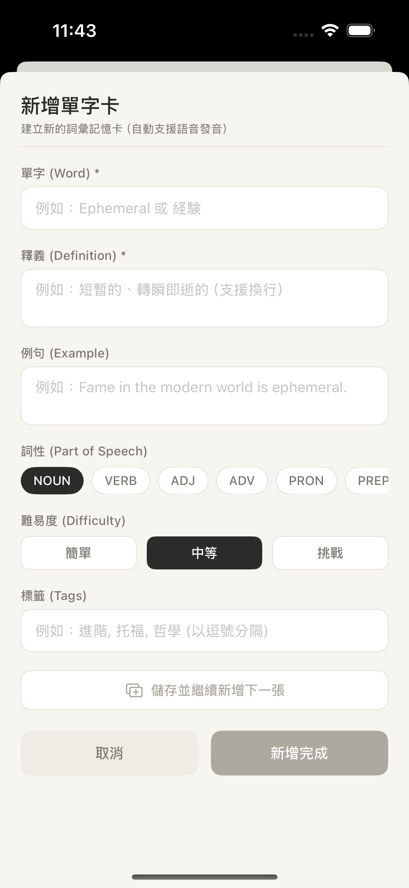
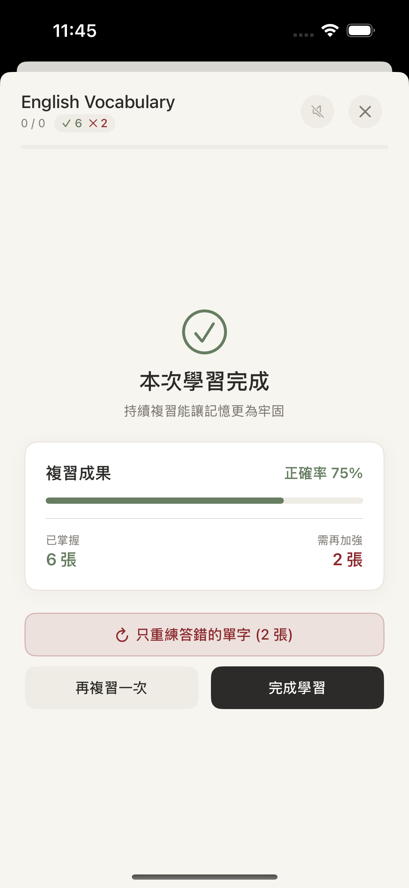
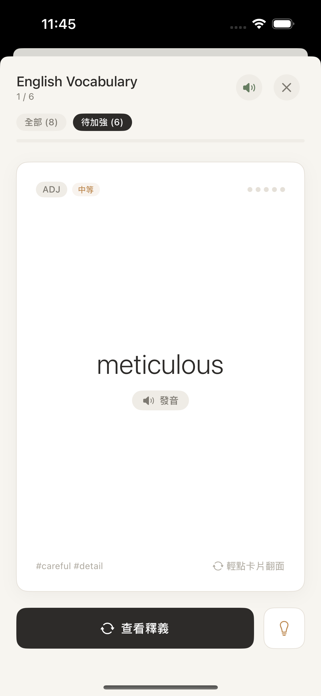
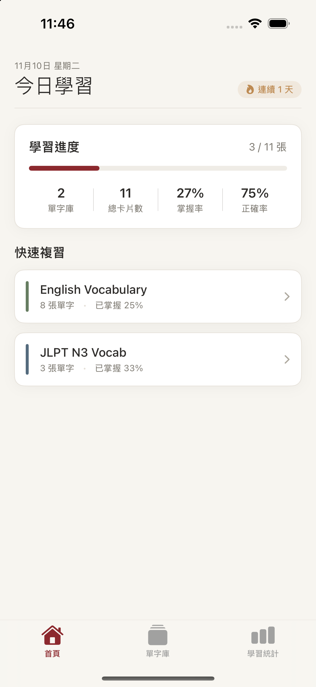

# MyCard 實機截圖與狀態驗證紀錄 (Index)

本目錄記錄依據 App 核心使用流程實際於 iOS Simulator 操作並擷取的六大關鍵畫面狀態。

---

## 測試環境與版本資訊

* **專案名稱**：MyCard (ASCIIFlashCards)
* **原始碼 Commit 基準**：`b65e1f24d85ea1ca9333903102c46fbe8523c0bf` (`main` 分支最新已合併 PR #1)
* **測試分支 (Worktree)**：`test/screenshots-flow`（位於 `.worktrees/screenshots`）
* **App 識別碼 (Bundle ID)**：`com.ascii.flashcards`
* **目標裝置與系統**：iPhone 16 (`5BED8D0C-2F4B-497C-8A1E-28EB47BC6A17`) / iOS 18.6
* **建置環境**：Xcode 27.1 (Build 27A9275)
* **截圖擷取時間**：2026-11-10 11:42 ~ 11:47 (UTC+8)

---

## 工具可用性檢查

| 工具類別 | 實體工具 | 支援能力 (能做的部分) | 限制 (不能做的部分) |
| :--- | :--- | :--- | :--- |
| **建置工具** | `xcodebuild` | 支援將 Xcode 專案建置為 iPhone Simulator 相容之 Debug `.app` | 需要指定 `-derivedDataPath` 或使用非沙盒以允許寫入暫存 |
| **裝置控制** | `xcrun simctl` | 支援 Simulator 啟動 (`boot`)、關閉 (`shutdown`)、安裝 (`install`)、啟動 App (`launch`)、終止 App (`terminate`)、狀態查詢 | 無原生任意座標點擊手勢模擬指令 (Touch Events) |
| **畫面讀取與截圖** | `xcrun simctl io screenshot` | 支援即時擷取 Simulator 當前原生無失真 PNG 畫面，解析度高達 1179 x 2556 | 無內建 OCR 畫面文字讀取，需透過圖片檢視或 Accessibility Inspector |
| **獨立示範資料** | `SwiftData inMemory` & `CommandLine` | 透過 `-UITestMode` 與啟動參數使用純記憶體 ModelContainer，100% 隔離不更動實體資料庫 | 無 |

---

## 六大狀態截圖與驗證表

| 編號 | 狀態名稱 | 截圖檔案 | 操作與進入方式 | 預期與實際畫面結果 | 驗證判定 |
| :---: | :--- | :--- | :--- | :--- | :---: |
| **01** | **空白狀態** (無單字庫) | [01-empty.png](./01-empty.png) | 啟動參數 `-UITestMode -UITest_Empty`，進入「單字庫」頁籤 | 顯示單字庫數量 0、紙匣圖示 `tray`、「尚無單字庫」提示文字與「建立單字庫」、「載入範例字卡庫」按鈕。 | **成功** ✅ |
| **02** | **有資料狀態** (翻卡正面) | [02-active-data.png](./02-active-data.png) | 啟動參數 `-UITestMode -UITest_StudyFront`，載入預設單字庫開始學習 | 頂部顯示單字庫名稱、序號「1 / 8」；卡片正面顯示單字「meticulous」、詞性 `ADJ`、難度 `中等`、熟練度圓點與發音按鈕。 | **成功** ✅ |
| **03** | **輸入錯誤/防呆** (必填未填) | [03-input-error.png](./03-input-error.png) | 啟動參數 `-UITestMode -UITest_AddCard`，開啟新增單字表單 | 單字與釋義為必填，留空時「儲存並繼續新增下一張」文字變灰停用，「新增完成」按鈕背景轉為淺灰色 disabled 狀態，防呆生效。 | **成功** ✅ |
| **04** | **完成後狀態** (學習結算) | [04-completed.png](./04-completed.png) | 啟動參數 `-UITestMode -UITest_StudyFinished`，模擬翻卡評估結算 | 顯示綠色大打勾圖示 `checkmark.circle`、「本次學習完成」；成果卡片標明「正確率 75%」、「已掌握 6 張」、「需再加強 2 張」，並提供「只重練答錯的單字 (2 張)」紅色按鈕。 | **成功** ✅ |
| **05** | **設定切換狀態** (自動發音與範圍) | [05-settings-toggle.png](./05-settings-toggle.png) | 啟動參數 `-UITestMode -UITest_SettingsToggle`，切換設定狀態 | 頂部喇叭按鈕由靜音變為綠色音波圖示 `speaker.wave.2.fill`（開啟自動發音）；範圍按鈕切換至選中「待加強 (6)」Pill，卡片數相應調整為「1 / 6」。 | **成功** ✅ |
| **06** | **重新開啟狀態** (冷啟動持久化) | [06-reopen.png](./06-reopen.png) | 啟動參數 `-UITestMode -UITest_ReopenPersistence`，模擬複習後的冷啟動首頁 | 頂部展示「連續 1 天」火焰圖示 🔥；學習進度儀表板顯示正確率 75%、總卡片 11 張，下方條列兩組單字庫與掌握率，資料完整持久化呈現。 | **成功** ✅ |

---

## 截圖預覽 (Gallery)

### 01 - 空白狀態

---

### 02 - 有資料狀態 (翻卡學習正面)

---

### 03 - 輸入錯誤／防呆驗證狀態

---

### 04 - 完成後狀態 (學習成果結算)

---

### 05 - 設定切換狀態 (語音自動播放與範圍切換)

---

### 06 - 重新開啟狀態 (冷啟動後進度與連續天數)

---

## 統計結果

* **成功項目**：6 項
* **失敗項目**：0 項
* **未完成項目**：0 項（全數以真實 Simulator 操作並逐張檢驗，無任何重複或假造畫面）
